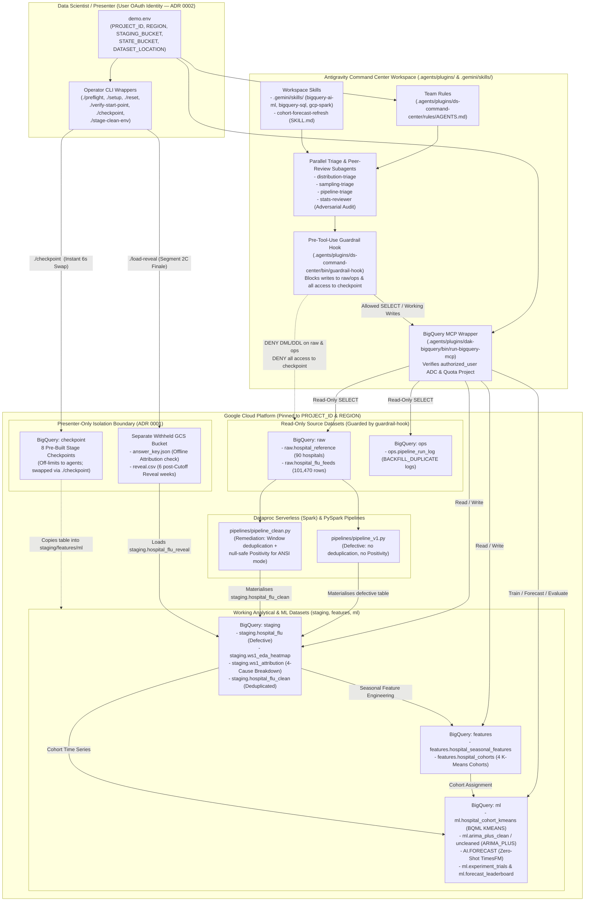

# Antigravity for Data Scientists (`ds-command-center`)

A reusable, end-to-end live demonstration and reference workspace for data science teams operating in the **Antigravity Command Center**. Across two connected **Workstreams**, a data scientist directs specialized agents and subagents to investigate whether a **+35% week-over-week Northeast flu Spike** across 90 hospitals (through the **Cutoff**, Saturday, October 31, 2026) is a genuine localized **Outbreak**, a **Sampling Artifact**, or a **Pipeline Defect**, remediates the PySpark ingestion pipeline on **Dataproc Serverless**, and builds **Cohort**-level time-series forecasts in **BigQuery ML** (`KMEANS`, `ARIMA_PLUS`, and zero-shot `TimesFM` via `AI.FORECAST`) before evaluating them against six withheld post-**Cutoff** **Reveal** weeks.

> **Looking to present or rehearse the live session?** Go straight to **[DEMO.md](DEMO.md)** or the detailed **[Presenter Runbook](docs/presenter-runbook.md)**.

---

## Table of Contents

1. [Core Narrative & Three Key Takeaways](#1-core-narrative--three-key-takeaways)
2. [System Architecture](#2-system-architecture)
3. [Repository Structure](#3-repository-structure)
4. [Prerequisites & Environment Setup](#4-prerequisites--environment-setup)
5. [Working with the Project (CLI & Lifecycle Guide)](#5-working-with-the-project-cli--lifecycle-guide)
6. [Development, Linting & Testing](#6-development-linting--testing)
7. [Documentation & Reference Index](#7-documentation--reference-index)

---

## 1. Core Narrative & Three Key Takeaways

In the week ending on the **Cutoff** (`2026-10-31`), raw flu-positive test counts (`positive_flu_tests`) across Northeast facilities jump **+35% week-over-week**. Before clinical leadership acts on that headline **Spike** or trains downstream forecasting models, the data science team uses the **Command Center** to execute two **Workstreams**:

* **Workstream 1 — *"Is the Data Good to Use?"***: Profile `staging.hospital_flu`, dispatch three triage subagents (`distribution-triage`, `sampling-triage`, `pipeline-triage`) in parallel to quantify a four-cause **Attribution** (`15.0` pts **Pipeline Defect** + `8.0` pts **Sampling Artifact** + `7.0` pts localized **Outbreak** + `5.0` pts **Seasonal Ramp** = `+35.0%`), challenge the findings with an adversarial statistical peer-review subagent (`stats-reviewer`), review the `git diff` for `pipelines/pipeline_clean.py`, and run the deduplicated, null-safe **Positivity** pipeline on **Dataproc Serverless**.
* **Workstream 2 — *"Forecast at Scale" & The Reveal***: Engineer four seasonal curve features per hospital (`features.hospital_seasonal_features`), segment the 90 facilities into four **Cohorts** using BigQuery ML `KMEANS` (`features.hospital_cohorts`), benchmark multi-series `ARIMA_PLUS` against zero-shot `TimesFM` (`AI.FORECAST`) by chronological backtest **WAPE** (`ml.experiment_trials` and `ml.forecast_leaderboard`), load the six withheld post-**Cutoff** **Reveal** weeks to prove that models trained on cleaned data track reality while uncleaned models overshoot, and codify the workflow into a repeatable team skill (`cohort-forecast-refresh`).

### Three Messages Landed by This Project

1. **It fits existing data science stacks**: Agents operate directly against BigQuery, Dataproc Serverless, PySpark, BigQuery ML, and versioned SQL in git.
2. **One data scientist directs a team of specialized agents and reviews the evidence**: Parallel triage subagents and an adversarial `stats-reviewer` gather SQL evidence, while the human data scientist approves code diffs before production execution.
3. **Skills, subagents, hooks, and MCP wiring are files your team owns, versions, and shares**: Every rule, pre-tool-use guardrail hook, subagent prompt, skill definition, and MCP wrapper lives as plain text inside `.agents/plugins/`.

---

## 2. System Architecture



### Key Architectural Invariants

1. **Presenter-Identity-Only Execution ([ADR 0002](docs/adr/0002-dataproc-runs-as-presenter.md))**:
   - No custom service accounts or `google_*_iam_*` bindings are created by Terraform (`infra/main.tf`).
   - Dataproc Serverless batches (`bin/run-pipeline-v1`, `bin/run-pipeline-clean`), BigQuery queries, BigQuery ML jobs, and the BigQuery MCP wrapper (`.agents/plugins/dak-bigquery/bin/run-bigquery-mcp`) execute under the presenter's user credentials (`type: authorized_user`) with `BILLING_QUOTA_PROJECT_ID` pinned to `PROJECT_ID`.
2. **Hard Dataset Guardrails (`.agents/plugins/ds-command-center/bin/guardrail-hook`)**:
   - Wired via `.agents/plugins/ds-command-center/hooks.json` (`before_tool_use`), the guardrail hook inspects both BigQuery MCP SQL calls (`execute_sql`) and shell commands (`bq`, `gcloud`) before execution.
   - Blocks any mutating statement (`INSERT`, `UPDATE`, `DELETE`, `MERGE`, `CREATE`, `DROP`, `TRUNCATE`, `ALTER`) targeting `raw` or `ops`, and blocks **all** access (including `SELECT` and metadata listing) targeting `checkpoint`.
3. **Withheld Evaluation Data Outside Agent Reach ([ADR 0001](docs/adr/0001-answer-key-outside-agent-reach.md))**:
   - The **Data Generator** writes the visible pre-**Cutoff** dataset (`through 2026-10-31`) separately from the withheld evaluation bundle (`answer_key.json` and the six post-**Cutoff** **Reveal** weeks `2026-11-01`..`2026-12-12`).
   - Live `answer_key.json` and `reveal.csv` files live in a separate presenter-owned Cloud Storage bucket and are never committed to the repository or referenced in `demo.env` (hermetic mock fixtures exist only under `fixtures/mock_withheld/` for automated unit tests).

---

## 3. Repository Structure

```text
.
├── .agents/
│   ├── skills.json                              # Points workspace subagents to .gemini/skills
│   └── plugins/
│       ├── dak-bigquery/                        # Workspace BigQuery MCP plugin & ADC wrapper
│       │   ├── bin/run-bigquery-mcp             # Validates authorized_user ADC & quota project
│       │   ├── mcp/bin/mcp_proxy_bundle.cjs     # Vendored Apache-2.0 BigQuery MCP stdio proxy
│       │   ├── mcp_config.json                  # MCP server declaration
│       │   └── plugin.json                      # Plugin manifest
│       └── ds-command-center/                   # Team-owned Command Center plugin
│           ├── agents/                          # 4 specialized subagents:
│           │   ├── distribution-triage.md       #   Separates localized Outbreak from Seasonal Ramp
│           │   ├── pipeline-triage.md           #   Correlates duplicates with ops.pipeline_run_log
│           │   ├── sampling-triage.md           #   Detects testing expansion with flat Positivity
│           │   └── stats-reviewer.md            #   Adversarial statistical peer reviewer
│           ├── bin/guardrail-hook               # Pre-tool-use dataset boundary enforcement hook
│           ├── hooks.json                       # Registers bin/guardrail-hook on before_tool_use
│           ├── rules/AGENTS.md                  # Team rules (project pinning, dataset boundaries)
│           └── skills/cohort-forecast-refresh/  # Repeatable Workstream 2 forecast refresh skill
├── bin/                                         # Operator & automation scripts (symlinked at root)
│   ├── bootstrap-tf-state                       # Creates gs://${STATE_BUCKET} & runs terraform init
│   ├── check-glossary.js                        # Enforces GLOSSARY.md vocabulary across repo files
│   ├── checkpoint                               # Lists, builds, and swaps pre-built Checkpoints
│   ├── generate-dataset                         # External Data Generator CLI (--scale mock|full)
│   ├── load-raw-ops                             # Loads raw.hospital_reference, raw.hospital_flu_feeds, ops
│   ├── load-reveal                              # Loads post-Cutoff Reveal weeks into staging & ml
│   ├── preflight                                # 12-point pre-stage readiness verification
│   ├── reset                                    # Resets working datasets to ws1 or ws2 Start Point
│   ├── run-cohort-forecast-refresh              # Executes the cohort-forecast-refresh skill workflow
│   ├── run-pipeline-clean                       # Submits/verifies pipelines/pipeline_clean.py
│   ├── run-pipeline-v1                          # Submits defective pipelines/pipeline_v1.py
│   ├── run-ws2-cohorts                          # Runs seasonal features & BQML K-means Cohorts
│   ├── run-ws2-forecasts                        # Runs ARIMA_PLUS & AI.FORECAST + leaderboard
│   ├── setup                                    # End-to-end initial seeding & ws1 Start Point setup
│   ├── stage-clean-env                          # Stashes/restores personal ~/.gemini rules & skills
│   ├── verify-main-end-state                    # Verifies full post-Reveal end state vs Answer Key
│   └── verify-start-point                       # Verifies ws1, ws2, or main state & Checkpoint parity
├── docs/                                        # Detailed presenter, reuser, and architecture docs
│   ├── adr/                                     # ADR 0001 (Answer Key isolation) & ADR 0002 (Identity)
│   ├── agents/                                  # Issue tracker, triage labels, and domain conventions
│   ├── data-science-primer.md                   # Methodological intuitions & Q&A defense playbook
│   ├── demo-outline.md                          # 90-minute narrative arc & audience tailoring guide
│   ├── presenter-runbook.md                     # Detailed stage script with timings & prompts
│   ├── recorded_runtimes.json                   # Empirical job runtimes from live GCP execution
│   └── reuser-guide.md                          # Provisioning, IAM, DAK skills, Java 21 & ADC guide
├── fixtures/                                    # Deterministic hermetic fixtures for unit testing
│   ├── mock_dataset/                            # Pre-Cutoff mock Hospital Feeds & ops logs
│   └── mock_withheld/                           # Mock answer_key.json & reveal.csv for offline tests
├── infra/                                       # Terraform infrastructure definitions (no IAM/SAs)
│   ├── backend.tf                               # GCS backend configuration
│   ├── main.tf                                  # APIs, VPC/Subnet, staging bucket, 6 BQ datasets
│   ├── outputs.tf                               # Provisioned resource outputs
│   └── variables.tf                             # Input variables populated via TF_VAR_* in demo.env
├── lib/                                         # Python implementation libraries
│   └── data_generator.py                        # Deterministic synthetic Hospital Feed generator
├── pipelines/                                   # PySpark jobs for Dataproc Serverless
│   ├── pipeline_v1.py                           # Defective v1 pipeline (no dedup, no Positivity)
│   └── pipeline_clean.py                        # Remediated pipeline (Window dedup + null-safe Positivity)
├── sql/                                         # Canonical BigQuery & BigQuery ML SQL scripts
│   ├── ws1_eda_heatmap.sql                      # Workstream 1A hospital x week Spike concentration
│   ├── ws1_attribution.sql                      # Workstream 1B 4-cause Attribution reconciliation
│   ├── ws1_pipeline_clean_equiv.sql             # Reference SQL specification for pipeline_clean.py
│   ├── ws2_seasonal_features.sql                # Workstream 2A per-hospital seasonal curve features
│   ├── ws2_kmeans_cohorts.sql                   # Workstream 2A BQML K-means model & Cohort assignment
│   ├── ws2_forecasts_and_trials.sql             # Workstream 2B ARIMA_PLUS + AI.FORECAST + trials
│   ├── ws2_forecast_leaderboard.sql             # Workstream 2B chronological backtest WAPE ranking
│   ├── ws2_reveal_evaluation.sql                # Workstream 2C post-Cutoff Reveal vs forecast evaluation
│   └── ws2_cohort_forecast_refresh.sql          # Workstream 2D parameterized weekly refresh query
├── tests/                                       # Standard library unittest suite (120+ tests)
├── CODING_STANDARDS.md                          # Shell, Python, preflight, and test standards
├── DEMO.md                                      # Live demo walkthrough, prompts & Checkpoint guide
├── GLOSSARY.md                                  # Canonical project vocabulary & prohibited terms
├── Makefile                                     # Build, lint, glossary check, and test targets
└── demo.env.example                             # Template environment file
```

---

## 4. Prerequisites & Environment Setup

For complete provisioning details and troubleshooting, see the **[Reuser Setup & Operations Guide](docs/reuser-guide.md)**. Below is the step-by-step workflow to bring up a fresh environment.

### Step 1: Configure `demo.env`

Copy the template and set your Google Cloud project, region, buckets, and dataset location:

```bash
cp demo.env.example demo.env
```

Edit `demo.env`:

```bash
PROJECT_ID="your-demo-project-id"
REGION="us-central1"
STAGING_BUCKET="your-dataproc-staging-bucket"
STATE_BUCKET="your-terraform-state-bucket"
SUBNET="" # Leave empty to let Terraform create demo-dataproc-vpc & demo-dataproc-subnet
DATASET_LOCATION="gs://${STAGING_BUCKET}/dataset" # Full-scale Data Generator hand-off root (90 hospitals; leave empty to use fixtures/mock_dataset)
```

Load `demo.env` into your shell (which also exports `CLOUDSDK_CORE_PROJECT`, `CLOUDSDK_COMPUTE_REGION`, `GOOGLE_CLOUD_PROJECT`, `GOOGLE_CLOUD_QUOTA_PROJECT`, and `TF_VAR_*`):

```bash
source demo.env
gcloud config set project "${PROJECT_ID}"
gcloud config set compute/region "${REGION}"
```

### Step 2: Verify Presenter Authentication & ADC Quota Alignment ([ADR 0002](docs/adr/0002-dataproc-runs-as-presenter.md))

Ensure your user account has the minimum required roles on `PROJECT_ID` (`roles/serviceusage.serviceUsageAdmin`, `roles/compute.networkAdmin`, `roles/compute.securityAdmin`, `roles/storage.admin`, `roles/bigquery.admin`, `roles/dataproc.editor`) and align your user OAuth Application Default Credentials (ADC) quota project:

```bash
gcloud auth login
gcloud auth application-default login
gcloud auth application-default set-quota-project "${PROJECT_ID}"
```

### Step 3: Bootstrap Terraform State & Provision Infrastructure

Create the dedicated Terraform state bucket (`gs://${STATE_BUCKET}`) and apply `infra/`:

```bash
source demo.env
./bin/bootstrap-tf-state
terraform -chdir=infra plan
terraform -chdir=infra apply
```

This enables the required Google Cloud APIs, creates `demo-dataproc-vpc` and `demo-dataproc-subnet` (with Private Google Access), creates `gs://${STAGING_BUCKET}`, and provisions the six BigQuery datasets (`raw`, `ops`, `staging`, `features`, `ml`, `checkpoint`) labeled `demo:true`.

### Step 4: Install Licensed Data Agent Kit Skills & Java 21

1. **Workspace Data Agent Kit Skills (`.gemini/skills/`)**:
   Subagents discover workspace skills through `.agents/skills.json` → `.gemini/skills/`. Copy your licensed Data Agent Kit skills into `.gemini/skills/` (which is gitignored so licensed skills are not redistributed):
   ```bash
   mkdir -p .gemini/skills
   cp -R "${HOME}/.gemini/config/plugins/data-agent-kit-plugin/skills/"* .gemini/skills/
   ```
2. **Java 21 for Local Spark Unit Tests**:
   Apache Spark requires Java 17 or **Java 21** (`openjdk@21`) and fails on Java 25+:
   ```bash
   brew install openjdk@21
   export JAVA_HOME="/opt/homebrew/opt/openjdk@21/libexec/openjdk.jdk/Contents/Home"
   export PATH="${JAVA_HOME}/bin:${PATH}"
   ```

### Step 5: Generate or Seed the Dataset & Build Checkpoints

To generate the deterministic full-scale dataset (`90` hospitals, `101,470` **Hospital Feed** rows, `seed=42`) outside the repository and upload the visible tables to `DATASET_LOCATION`:

```bash
./bin/generate-dataset --scale full --seed 42 \
  --visible-dir "${HOME}/ace/flu-demo-data/visible" \
  --withheld-dir "${HOME}/ace/flu-demo-data/withheld"

gcloud storage cp --project="${PROJECT_ID}" -r \
  "${HOME}/ace/flu-demo-data/visible/*" "${DATASET_LOCATION}/"
```

*(Store the `--withheld-dir` contents in a separate presenter-only Cloud Storage bucket per [ADR 0001](docs/adr/0001-answer-key-outside-agent-reach.md)).*

Then seed the project, build all eight stage **Checkpoints**, and run `./preflight`:

```bash
source demo.env
./setup
./checkpoint --build all
./preflight
./verify-start-point ws1
```

---

## 5. Working with the Project (CLI & Lifecycle Guide)

All primary operator scripts live in `bin/` and have root-level convenience symlinks:

| Command | Purpose |
| :--- | :--- |
| `./preflight` | Runs all 12 readiness checks: `demo.env`, active `gcloud` project/region, ADC quota project health, Dataproc Serverless execution, BigQuery MCP authentication, `guardrail-hook` enforcement, BigQuery ML (`AI.FORECAST` + `KMEANS`), subagent dispatch, `.gemini/skills/` visibility, and Java 21. |
| `./setup [dataset_location]` | Seeds `raw` and `ops` from `DATASET_LOCATION` (or `fixtures/mock_dataset`), runs `pipelines/pipeline_v1.py` to populate defective `staging.hospital_flu`, and verifies the **Workstream** 1 **Start Point**. |
| `./reset ws1` | Resets `staging`, `features`, and `ml` back to the clean **Workstream** 1 **Start Point** (`staging.hospital_flu` populated with defective data; downstream tables cleared). |
| `./reset ws2` | Resets `staging`, `features`, and `ml` to the **Workstream** 2 **Start Point** (where **Workstream** 1 ends: `staging.ws1_eda_heatmap`, `staging.ws1_attribution`, and `staging.hospital_flu_clean` materialised; `features` and `ml` cleared). |
| `./verify-start-point ws1\|ws2\|main` | Validates table schemas, row counts, invariants, and `checkpoint` parity for `ws1`, `ws2`, or the full post-**Reveal** `main` end state (`--withheld-dir <path-or-gs-uri>`). |
| `./run-pipeline-clean` | Submits `pipelines/pipeline_clean.py` to Dataproc Serverless (`--async` for background stage execution, `--sql-fallback` for instant 5s BigQuery materialisation, `--verify-equivalence` to check parity with `sql/ws1_pipeline_clean_equiv.sql`). |
| `./run-ws2-cohorts` | Computes `features.hospital_seasonal_features` and trains BQML `ml.hospital_cohort_kmeans` to populate `features.hospital_cohorts`. |
| `./run-ws2-forecasts` | Trains multi-series BQML `ARIMA_PLUS` models (clean vs uncleaned), runs zero-shot `TimesFM` (`AI.FORECAST`), logs trials to `ml.experiment_trials`, and builds `ml.forecast_leaderboard`. |
| `./load-reveal <withheld_dir_or_gs_uri>` | Loads the six post-**Cutoff** **Reveal** weeks (`2026-11-01`..`2026-12-12`) into `staging.hospital_flu_reveal` and computes `ml.reveal_forecast_evaluation`. |
| `./run-cohort-forecast-refresh --period 2026-W44` | Executes the parameterized `cohort-forecast-refresh` skill workflow (`sql/ws2_cohort_forecast_refresh.sql`) for the specified epidemiological period. |
| `./checkpoint --list \| --build all \| <id>` | Lists, builds, or swaps any of the 8 pre-built stage **Checkpoints** in ~6 seconds (`ws1_pipeline_v1`, `ws1_eda_heatmap`, `ws1_attribution`, `ws1_staging_clean`, `ws2_seasonal_features`, `ws2_hospital_cohorts`, `ws2_experiment_trials`, `ws2_forecast_leaderboard`). |
| `./stage-clean-env --stash \| --status \| --restore` | Temporarily moves personal `~/.gemini` rules and non-DAK skills into `~/.gemini/.demo-stage-stash` before going on stage and restores them afterward. |

### Start Point Git Branches

* `workstream-1-start`: Clean code and workspace state at the beginning of **Workstream** 1.
* `workstream-2-start`: Linear descendant of `workstream-1-start` containing the completed **Workstream** 1 artifacts, ready to begin **Workstream** 2 after an intermission.
* `main`: Complete end-to-end repository state including all **Workstream** 1 and **Workstream** 2 implementations, tests, and documentation.

---

## 6. Development, Linting & Testing

The repository enforces strict formatting, linting, glossary compliance, and hermetic unit tests via `Makefile` and GitHub Actions CI (`.github/workflows/ci.yml`).

### Run the Full Verification Suite

```bash
uvx ruff check . && uvx ruff format --check . && make test
```

What `make test` runs:
1. **Glossary Check (`make check-glossary` / `node bin/check-glossary.js`)**: Scans all git-tracked files against [GLOSSARY.md](GLOSSARY.md) to ensure canonical terms are used and prohibited synonyms are absent.
2. **Script & Syntax Validation (`make check`)**: Validates bash syntax (`bash -n`), Node syntax (`node --check`), Python compilation (`py_compile`), and Ruff linting/formatting (`ruff check . && ruff format --check .`).
3. **Unit Test Suite (`python3 -m unittest discover -s tests`)**: Executes 120+ hermetic unit tests covering preflight checks, Terraform configurations, the `Data Generator`, `guardrail-hook`, BigQuery MCP wrapper authentication, **Workstream** 1 EDA/triage/equivalence/PySpark tests, **Workstream** 2 K-means/forecasting/**Reveal**/skill tests, and documentation compliance.

### Branch & Pull Request Workflow

* `main` is branch-protected and requires the `CI / Check & Test` GitHub Actions check to pass before merging.
* Develop changes in an isolated git worktree (`.worktree/<branch-slug>`), run `uvx ruff check . && uvx ruff format --check . && make test`, open a Pull Request (`gh pr create`), and squash-merge once CI is green.

---

## 7. Documentation & Reference Index

| Document | Description |
| :--- | :--- |
| **[DEMO.md](DEMO.md)** | **How to demo this project**: Pre-stage setup, 90-minute timeline, copy-paste **Command Center** prompts, speaker narration, **Checkpoint** swaps, and 45/60-minute cuts. |
| **[GLOSSARY.md](GLOSSARY.md)** | Canonical domain vocabulary (`Command Center`, `Hospital Feed`, `Positivity`, `Spike`, `Cutoff`, `Pipeline Defect`, `Sampling Artifact`, `Outbreak`, `Seasonal Ramp`, `Attribution`, `Answer Key`, `Cohort`, `Reveal`, `Workstream`, `Start Point`, `Checkpoint`) and prohibited terms. |
| **[Presenter Runbook](docs/presenter-runbook.md)** | Detailed on-stage execution script with minute-by-minute clock windows and early-start job triggers. |
| **[Reuser Setup & Operations Guide](docs/reuser-guide.md)** | Complete guide for provisioning a new GCP project, configuring IAM ([ADR 0002](docs/adr/0002-dataproc-runs-as-presenter.md)), installing Data Agent Kit skills, setting up Java 21, and resolving stale ADC quota project errors. |
| **[Data Science Primer](docs/data-science-primer.md)** | Plain-language statistical intuitions and 10-second stage answers for defending **Positivity**, **Sampling Artifacts**, Simpson's Paradox, K-means **Cohorts**, `ARIMA_PLUS`, `TimesFM`, chronological backtesting, and **WAPE**. |
| **[Demo Outline](docs/demo-outline.md)** | Executive narrative blueprint, audience tailoring guide (Data Scientists, Data Engineers, Analytics Leaders, Executives), and cross-industry translation matrix. |
| **[Recorded Runtimes](docs/recorded_runtimes.json)** | Empirical execution times recorded against Google Cloud for Dataproc Serverless batches, BigQuery ML models, resets, and **Checkpoint** swaps. |
| **[CODING_STANDARDS.md](CODING_STANDARDS.md)** | Engineering conventions for CLI scripts (`bin/*`), preflight modularity, Python determinism, and `unittest` seams. |
| **[ADR 0001](docs/adr/0001-answer-key-outside-agent-reach.md)** | Architecture Decision Record: Why the **Answer Key** and post-**Cutoff** **Reveal** data live outside agent reach. |
| **[ADR 0002](docs/adr/0002-dataproc-runs-as-presenter.md)** | Architecture Decision Record: Why Dataproc Serverless, BigQuery, and BigQuery MCP run under the presenter's user identity. |
