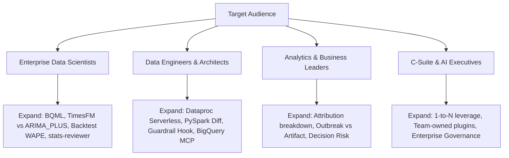

# Antigravity for Data Scientists: Live Demo Outline

A company-neutral, 90-minute live demonstration script, timing blueprint, and audience tailoring guide. This outline shows how a presenter can deliver the full narrative without editing the repository's core content.

All terminology adheres strictly to [GLOSSARY.md](../GLOSSARY.md).

---

## 1. Executive Summary & The Three Core Messages

The demonstration centers on a single realistic scenario: an unexpected **Spike** (+35% week-over-week in the week ending on the **Cutoff**, Saturday, October 31, 2026) in flu-positive test counts across 90 synthetic hospitals. Data scientists are skeptical of opaque AI tools that fabricate answers without evidence or disregard their established technical stack.

The demonstration lands three foundational messages:

1. **It fits how you work today**:
   The Command Center does not force teams into proprietary notebooks or walled gardens. It operates directly with BigQuery, Dataproc Serverless, PySpark, BQML, and versioned SQL in the repository.
2. **One data scientist directs an army of agents and reviews the evidence**:
   The human data scientist remains the architect and decision-maker. Specialized subagents work in parallel to perform exploratory data analysis, cross-check operational logs, and peer-review findings, but human approval is required before executing changes to pipeline code.
3. **Skills, subagents, hooks and MCP wiring are files your team owns, versions and shares**:
   Orchestration and governance are not black-box cloud settings. Everything—subagent definitions, analysis workflows, safety hooks, and MCP connections—is versioned as plain text within the repository plugin directory (`ds-command-center`).

---

## 2. Master 90-Minute Agenda

| Segment | Duration | Primary Focus | Key Audience Takeaway |
| :--- | :--- | :--- | :--- |
| **Opening** | **12 min** | Command Center 101, Problem Framing, Guardrail Hook Demo | Ground rules, safety, and why existing tools fail. |
| **Workstream 1** | **35 min** | "Is the data good to use?": EDA, Subagents, Attribution, PySpark Fix | Rigorous data investigation, agent peer review, and human-in-the-loop fix. |
| **Workstream 2** | **28 min** | "Forecast at scale": Features, Cohorts, ARIMA_PLUS, TimesFM, Codifying Skill | Scalable modeling, foundation models vs classical baselines, and team reusability. |
| **The Reveal** | *(incl. in WS2)* | Six-week withheld data comparison | Visually proves that uncleaned models fail and clean models hold. |
| **Q&A** | **15 min** | Audience Defense, Architecture, and Methodological Justifications | Resolving technical skepticism using the Data Science Primer. |
| **Total** | **90 min** | **End-to-End Rehearsable Live Demonstration** | |

---

## 3. Detailed Segment Walkthrough

### 3.1 Opening (12 Minutes): The Command Center & Guardrails

* **Goal**: Establish the Command Center mental model, show safety controls in action, and introduce the anomaly.
* **Timing**:
  * **00:00 – 04:00 (Hook & Narrative Setup)**:
    * Introduce the operational scenario: a +35% Spike in flu-positive test counts across 90 Northeast hospitals in the week ending on the Cutoff (October 31, 2026).
    * Highlight the central dilemma: is this an **Outbreak**, a **Sampling Artifact**, a **Pipeline Defect**, or the **Seasonal Ramp**?
    * *Message 1 & 2 landed*: Emphasize that answering this requires deep data verification, not automated guesses.
  * **04:00 – 08:00 (Command Center 101 & Workspace Plugin)**:
    * Orient the audience to the layout: Antigravity acts as the Command Center directing tasks across files, terminals, BigQuery, and Dataproc.
    * Inspect the `ds-command-center` plugin folder: showcase that rules, custom subagents, and skills are plain files checked into git.
    * *Message 3 landed*: Demonstrate that configuration is transparent, versioned, and team-owned.
  * **08:00 – 12:00 (The Guardrail Hook Demonstration)**:
    * Live test: instruct the agent to drop or alter a table in the `raw` or `ops` dataset.
    * Observe the pre-tool-use guardrail hook intercept and immediately block the operation with an explicit explanation.
    * *Key takeaway*: The agent cannot corrupt source systems or raw data; safety policies are programmatically enforced.

---

### 3.2 Workstream 1 (35 Minutes): "Is the Data Good to Use?"

* **Goal**: Unpack the Spike, run parallel triage subagents, conduct peer review with `stats-reviewer`, approve a PySpark deduplication fix, and execute it on Dataproc Serverless.
* **Timing**:
  * **12:00 – 17:00 (Profiling, Heatmap & Concentration)**:
    * Query the defective `staging.hospital_flu` table via BigQuery MCP.
    * Generate a hospital-by-week heatmap and concentration metric.
    * The visualization reveals that the Spike is not uniform: certain hospitals exhibit extreme swings while others follow standard seasonal patterns.
  * **17:00 – 24:00 (Parallel Subagent Dispatch & Attribution Table)**:
    * Prompt the Command Center to launch three parallel triage subagents:
      1. *Distribution Subagent*: Analyzes spatial concentration and hospital variances.
      2. *Sampling Subagent*: Compares test volume to Positivity. Identifies ~6 hospitals with surged test volume but flat Positivity (Sampling Artifact contributing ~8 points).
      3. *Pipeline Subagent*: Correlates anomaly timestamps against the `ops.pipeline_run_log`. Discovers a backfill job that re-sent 5 days of Hospital Feeds for ~8 hospitals (Pipeline Defect contributing ~15 points).
    * Synthesize findings into a unified **Attribution** table (+35% total Spike):
      * **Pipeline Defect**: ~15 points
      * **Sampling Artifact**: ~8 points
      * **Outbreak**: ~7 points (3 neighboring hospitals with true Positivity rises)
      * **Seasonal Ramp**: ~5 points (expected baseline increase across all facilities)
  * **24:00 – 28:00 (Adversarial Challenge: `stats-reviewer`)**:
    * Dispatch the custom `stats-reviewer` subagent to audit the Attribution table.
    * The reviewer challenges the team on counts vs rates, small-sample hospitals with erratic swings, and tests for Simpson's Paradox across regional aggregations.
    * *Message 2 landed*: Demonstrates multi-agent peer review before human sign-off.
  * **28:00 – 35:00 (Human-Reviewed PySpark Fix & Dataproc Serverless Execution)**:
    * Request a remediation fix in the PySpark pipeline code (`pipeline_v1.py` → `pipeline_v2.py`).
    * The agent proposes window-function deduplication (`ROW_NUMBER() OVER (PARTITION BY hospital_id, feed_date ORDER BY ingested_at DESC)`) and adds Positivity calculation.
    * Presenter carefully reviews the git diff on screen and explicitly approves the change.
    * Dispatch the PySpark batch job to Dataproc Serverless using the presenter's credentials (ADR 0002).
    * The job executes and materializes the clean staging table (`staging.hospital_flu_clean`).
    * *(Note: In rehearsal or in case of network latency, Checkpoint 1 can be swapped in immediately).*

---

### 3.3 Workstream 2 (28 Minutes): "Forecast at Scale" & The Reveal

* **Goal**: Engineer seasonal features, cluster hospitals into Cohorts with BQML K-means, benchmark ARIMA_PLUS against zero-shot TimesFM, log trials, codify a reusable skill, and execute the Reveal.
* **Timing**:
  * **47:00 – 53:00 (Feature Engineering & BQML K-means Cohorts)**:
    * Generate per-hospital seasonal features in BigQuery SQL: peak arrival week, peak volume, curve width, and baseline trend.
    * Train a BQML K-means model to cluster the 90 hospitals into four seasonal **Cohorts**.
    * The Outbreak hospitals cluster into an anomalous Cohort, confirming that segmentation captures genuine clinical differences.
  * **53:00 – 62:00 (Forecasting Benchmark: ARIMA_PLUS vs TimesFM)**:
    * Train BQML ARIMA_PLUS per Cohort as multiple time series on both clean and uncleaned data.
    * Run zero-shot foundation model forecasting using TimesFM via `AI.FORECAST`.
    * Every run writes metadata and metrics to `ml.experiment_trials` (model family, Cohort, training data version, backtest WAPE, runtime).
    * Query the experiment leaderboard:
      * Models trained on clean data consistently achieve lower backtest WAPE.
      * TimesFM delivers competitive zero-shot performance without manual hyperparameter tuning.
  * **62:00 – 67:00 (Codifying the `cohort-forecast-refresh` Skill)**:
    * Instruct Antigravity to codify the entire multi-step modeling process (feature generation, Cohort assignment, forecasting, and trial logging) into a reusable skill.
    * Show that the new skill is saved as a markdown specification in `.gemini/skills/cohort-forecast-refresh/SKILL.md`.
    * A fresh subagent is dispatched to execute the skill for the next period, demonstrating push-button workflow repeatability.
  * **67:00 – 75:00 (The Finale: The Reveal)**:
    * Explain that six weeks of true data after the Cutoff (through mid-December) were withheld by the Data Generator and stored only in a separate GCS bucket (ADR 0001).
    * Supply the bucket path at runtime; load the withheld data and overlay it on the forecasts.
    * **The Punchline**:
      * The forecast trained on uncleaned data visibly overshoots reality, deceived by the Pipeline Defect and Sampling Artifact.
      * The forecast trained on cleaned data tracks actual hospitalization trends tightly.
    * *Core takeaway*: AI modeling without rigorous data validation produces confident hallucinations; the Command Center ensures data trust from raw ingestion to final forecast.

---

### 3.4 Q&A & Methodology Defense (15 Minutes)

* **Goal**: Address audience questions and technical pushback using the [Data Science Primer](data-science-primer.md).
* **Timing**:
  * **75:00 – 85:00 (Moderated Technical Q&A)**:
    * Address questions on Positivity normalization, Simpson's Paradox, WAPE vs MAPE, zero-shot TimesFM limits, and Dataproc Serverless cost/performance.
  * **85:00 – 90:00 (Closing Takeaway & Call to Action)**:
    * Reiterate the three core messages.
    * Direct the audience to the repository to try the demo in their own GCP projects.

---

## 4. Audience Tailoring Guide (Zero-Code Tailoring)

Tailoring for an audience needs no edits to the repo's core content. The underlying synthetic data, PySpark pipeline, BigQuery ML models, and plugins remain completely unchanged. Presenters adapt the session entirely through **framing, emphasis, pacing, and narrative analogies**.

### 4.1 Audience Profiles & Emphasis Playbook

#### Profile A: Enterprise Data Science & ML Practitioners
* **Their Skepticism**: "AI tools write toy scripts that don't follow statistical best practices."
* **Presenter Focus**:
  * Spend more time in **Workstream 2** (extend to 32 minutes, compress Opening to 8 minutes).
  * Emphasize why ARIMA_PLUS is the proper classical benchmark and how `AI.FORECAST` zero-shot compares.
  * Highlight the backtesting methodology (respecting temporal causality) and why WAPE was chosen over MAPE.
  * Walk through the `stats-reviewer` prompt to show how adversarial peer-review catches Simpson's Paradox.

#### Profile B: Data Engineers & Platform Architects
* **Their Skepticism**: "AI tools break in production because they don't integrate with enterprise data pipelines or security policies."
* **Presenter Focus**:
  * Spend more time in **Workstream 1** and the **Guardrail Hook**.
  * Highlight the PySpark window-function deduplication and Dataproc Serverless batch execution.
  * Showcase the BigQuery MCP connection and credential pass-through (running as the presenter, ADR 0002).
  * Show how the guardrail hook blocks destructive DDL/DML on raw tables.

#### Profile C: Analytics & Business Intelligence Leaders
* **Their Skepticism**: "Will AI cause my team to make bad business decisions based on dirty data?"
* **Presenter Focus**:
  * Double down on the **Attribution** table in Workstream 1 and the **Reveal** finale.
  * Point out how declaring a false outbreak due to a Sampling Artifact or Pipeline Defect would lead to wasted clinical spend.
  * Emphasize the speed of root-cause investigation: resolving in 20 minutes what previously took three days of data profiling.

#### Profile D: C-Suite & AI Transformation Executives
* **Their Skepticism**: "Is this just another chatbot, or does it deliver tangible productivity and team leverage?"
* **Presenter Focus**:
  * Emphasize the leverage ratio: one data scientist directing three parallel subagents and an adversarial reviewer.
  * Highlight **Message 3**: everything is a versioned, team-owned file—skills, subagents, rules—protecting institutional knowledge.
  * Demonstrate the codification of the `cohort-forecast-refresh` skill as creating durable intellectual property for the enterprise.

---

### 4.2 Cross-Industry Narrative Translation Matrix

Presenters can immediately translate the demo's healthcare narrative to other industry domains during the Opening and Reveal without changing a single line of SQL, Python, or data:

| Industry Domain | The Anomaly (+35% Headline Spike) | Pipeline Defect (~15 pts) | Sampling Artifact (~8 pts) | True Event (~7 pts) | Seasonal Baseline (~5 pts) |
| :--- | :--- | :--- | :--- | :--- | :--- |
| **Healthcare (Default)** | Northeast flu positive test count spike | Batch backfill duplicated 5 days of feeds | Walk-in clinics expanded testing volume | Genuine localized flu Outbreak | Early-season autumn flu ramp |
| **Financial Services** | Suspicious credit card transaction alert spike | Ingestion retry duplicated gateway transaction events | Enhanced fraud detection rules flagged low-risk transactions | Coordinated card-skimming fraud ring | Pre-holiday retail shopping volume ramp |
| **SaaS / Cloud Platforms** | Daily active user churn spike | Webhook replay emitted duplicate account closure events | Telemetry SDK update expanded tracking to inactive trial accounts | Service outage caused genuine churn in one region | End-of-quarter subscription renewal cycle |
| **Supply Chain / Retail** | Distribution center inventory discrepancy spike | EDI feed resubmitted duplicate receiving receipts | Additional warehouse scanners deployed for audit | Genuine inventory shrinkage / theft at 3 hubs | Planned seasonal pre-holiday inventory build |
| **Manufacturing / IoT** | Factory sensor temperature alarm spike | Telemetry broker pipeline replayed cached packet stream | High-frequency telemetry enabled on test machinery | Critical bearing degradation on 3 production lines | Ambient summer factory floor temperature increase |

---

### 4.3 Modular Timing Adjustments (Checkpoints)

When session time is constrained (e.g., a 45-minute executive briefing or 60-minute meetup), presenters can accelerate live execution without altering core files by utilizing pre-built Checkpoints:

* **To save 8 minutes in Workstream 1**: Instead of waiting for the Dataproc Serverless batch job to finish, show the human review of the PySpark git diff, trigger the submit command, and immediately swap in Checkpoint 1 (`staging.hospital_flu_clean`).
* **To save 6 minutes in Workstream 2**: Run the zero-shot TimesFM query live, and swap in Checkpoint 2 for the multi-series ARIMA_PLUS training runs.

---

## 5. Presenter Readiness Checklist

- [ ] **Preflight Check**: Run `preflight` script to confirm BigQuery MCP identity, Dataproc Serverless batch permissions, BQML capabilities, and project/quota pinning.
- [ ] **Start Point**: Verify current branch is `workstream-1-start` and the defective `staging.hospital_flu` table is present.
- [ ] **Answer Key Isolation**: Ensure the Answer Key and Reveal data GCS bucket exists and is accessible only at runtime via CLI argument (ADR 0001).
- [ ] **Timing Clock**: Position a countdown timer visible from the presenter workstation to hit each milestone accurately.
- [ ] **Primer Handy**: Keep the [Data Science Primer](data-science-primer.md) open in a secondary window for quick reference during Q&A.
